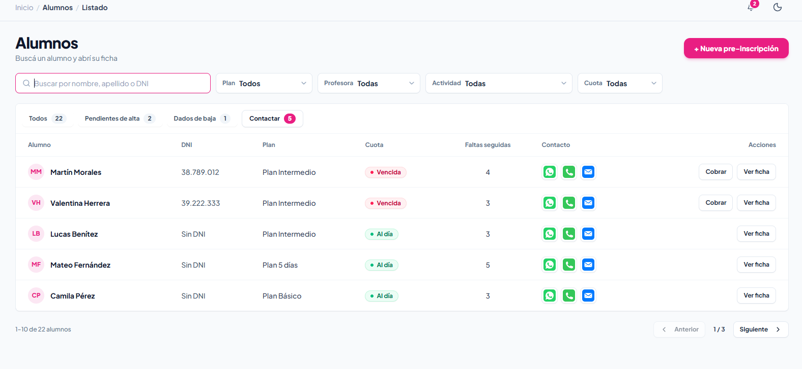
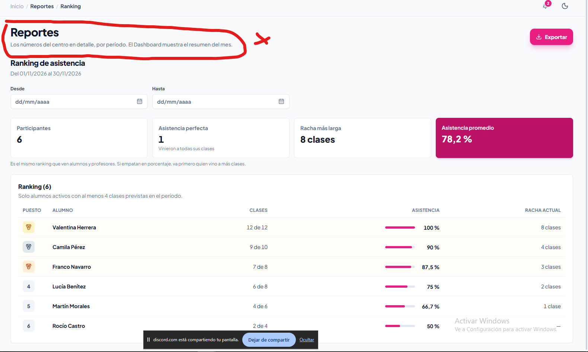
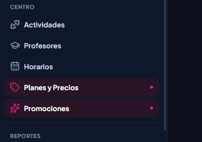

# Pendientes

## General

- [x] Que todas las esquinas (de las tablas u estados) o cornes tengan el mismo radios que tienen los filtros y el buscador que armamos en Listado y Ausentes. - Hacer Gaston Gil
- [x] Verificar consistencia de lo colores de botones (como estan en Listado o Ausentes) - Hacer Gaston Gil
- [x] Corregir consistencia de formularios (que sean simples). Un titulo, un subtitulo y formulario (evitar badges y colores en todos lados) - Hacer Gaston Gil

## Recarga

- [x] Al recargar la pagina tiene un loader, seria mejor tener un skeleteon (como lo hacen las paginas mordernas)

## Tablas

- [x] (que todas se vean como en la imagen) verificar que todas tengan el botón de accion.

## Filtros 

- [x] filtros (que todos los filtros se vean como en la imagen)

## Alumno - Ausentes

- [x] Poner un botón en vez de gestionar que diga Contactar y otro ignorar.
- [x] En faltas seguidas solo poner el numero con color y quitar los bordes y fondo.
- [x] El tutor dejarlo como esta Tel con ese color gris.
- [x] El teléfono sacarlo de ahí y ponerlo como columna al ultimo antes de los botones de  accion.
- [x] Que los filtros queden igual que el de la imagen.
- [x] Poner un buscador como el de la imagen.
- [x] En todos debería mostrar todos (incluido ignorado) 
- [x] Descripción reemplazar "Detección proactiva de alumnos con cuota al día y faltas reiteradas para contactar e incentivar su reintegro." por "Busca los alumnos ausentes que queres contactar"
- [x] Poner el estado (Contactar, Contactado, Ignorado) como una columna y manejar como el estado de Listado de alumno.
- [x] Agregar una columna con los iconos de whatsapp, mail y telefono. (sacar el formulario o ventana modal), solo dejar el boton para registrar que se contacto o el ignorar para ese caso (mantene el de los otros estados)
- [x] En la columna de ultima asitencia si estaba dentro de los 15 dias, que aparezca por ejemplo "Hace 5 dias", si supera los 15 dias que muestre la fecha correspondiente por ejemplo "El 09/06/2026".
- [x] Que los bordes queden como en la (imagen)[./image.png]  (mas cuadrados) y el buscador que tenga el mismo alto que los filtros.
- [x] Corregir mensajes al contactar "¡Hola Valentina! Te escribimos de MiFR Espacio de Danzas. Notamos que no pudiste venir a tus últimas clases de Plan Intermedio y te extrañamos. Queríamos saber si está todo bien o si querés coordinar una reposición. ¡Esperamos verte pronto!". Quitar "Espacio de danzas".
- [x] Sacar columna de plan y profesora.
- [x] El boton dice "Contactar" pero deberia decir "Contactado" para que haga el cambio de estado, verifica las otras tambien.
- [x] La columna de estados solo dejala en el apartado de "todos", en el resto sacala.
- [x] Cambiar el nombre en el sidebar de "Ausentes" por "Contactar" que tenga como icono un telefono.

## Alumno - Listado

- [x] Vista y filtros alineados con el diseño exacto de image.png con pestañas integradas en cabecera de tarjeta y botón de acción "Ver ficha".
- [x] Ordena los alumnos por Estado de Cuota, de manera que primero se visualicen las cuotas con mayor vencimiento.
- [x] Que la primera opcion de visualizacion sea "Todos", Quita "Activos"
- [ ] Arreglar error de "Sin dni" al aplicar filtro Contactar 

 
## Alumno - Cobros y Cuotas

- [x] Cambiar "Quién debe, qué transferencias faltan verificar y cuánto efectivo te tienen que rendir." por "Busca los deudores, que trasnferencias faltan verificar y cuanto efectivo te tienen que rendir"
- [x] Los buscadores y filtros mantene la estructura de Lista y Ausentes (incluido el responsive y los colores).
- [x] Columna informada quitale los colores y fondos, solo dejala como texto simple.
- [x] Efectivo a rendir que tambien sea tabla como venimos haciendo en Lista y Ausentes.
- [x] Arreglar rutas /app/pagos/transferencias no son pagos son cobros
- [x] Cambiar el boton de "Registrar Cobro", separarlo en dos "Cobrar Efectivo" y "Cobrar Transferencia".
- [x] En efectivo a rendir solo tiene que tener un boton de rendir sin formulario.
- [x] Agregar un listado de cobros en el apartado "Cobros" verificar el formato de las listas.
- [x] Cambiar el nombre  de "Listado" por "Historial" en el apartado "COBROS" - Gaston Gutierrez

## Honorario

- [x] Que al ingresar a honorarios no tenga que presionar el boton para calcular honorarios, que se haga apenas ingrese a la opcion.
- [x] "Se calculan con lo que pagan los alumnos de cada profesor/a y las suplencias del mes. El sistema no mueve dinero." reemplar por "Revisa el calculo del pago mensual para cada profesor/a"

## Clases - Actividades

- [x] Separar en dos columnas, actividad y descripcion.
- [x] En modalidad quitar los colores de la letra, el fondo y los bordes del badge. Solo dejar texto como en el resto de las columnas.

## Opcional

- [x] Donde de aparezca el alumno al hacer click que te lleve a su ficha.
- [x] Icono de perfil traerlo de google.

## Titulo sidebar Centro

- [x] Cambiar lo de "Centro" por "Otros".

## Propietaria - Horarios

- [x] Modificar estilo de horarios como estan en el rol de profesores "Mis Clases" - Hacer Gaston Gil

## Reportes

- [x] Separar en el sidebar como "ALUMNOS" un "REPORTES" que tenga los subitems "Inscripciones", "Planes", ..., etc.
- [x] Sacar el reporte cuotas vencidas y cobranza.
- [x] Arreglar Titulo duplicado (quitar Titulo Reportes de todos) y arreglar el path del bread  (Quedan dos en negrita) 
- [ ] Cambiar nombre de reporte "Planes" a "Planes mas elegidos"

## Clases

- [x] Modificar el nombre del sidebar "CLASES" por "CENTRO".
- [x] Reordenarlos poniendo "Actividades" primero, "Profesores" segundo y los otros dos dejalo igual.

## Quitar Cuotas

- [x] Necesito sacar cuotas y directamente en listado de alumnos que si la cuota esta por vencer o vencida que aparezca para en acciones cobrar. 

## Centro - Profesores

- [x] El icono del perfin del usuario/profesor que sea como el de Alumnos - Listado. - Gaston Gutierrez
- [x] En la columna de Incorporacion, saca el icono del calendario. - Gaston Gutierrez
- [x] Quitar "Limpiar filtros" al seleccionar historial completo

## Centro - Planes y Precios

- [x] Separa en subitems 'Planes y Precios' y Promociones - Gaston Gutierrez
- [x] Planes y precios que sean tablas como en "Alumnos - Listado" - Gaston Gutierrez
- [x] Promociones tambien hacer como tablas en "Alumnos - Listado" - Gaston Gutierrez

## Centro - Promociones

- [x] Quitar "Limpiar filtros" al seleccionar historial completo
- [x] Arreglar visualizacion de vigencia, remplazar "-" por "/"

- [x] Modificar breadcum para que coincida con pantalla
- [x] Arreglar bug al seleccionar opcion en sidebar 

## Centro - Planes
- [x] Cambiar nombre a unicamente "Planes"
